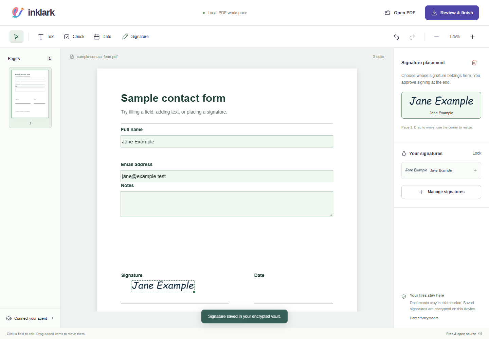

# Inklark

Fill PDFs and approve signatures locally, with a small browser workspace and tools for your existing agent. Free software under the MIT license. The app has no paid API, account requirement, or document quotas.

Your agent prepares the document and flags questions. You review the filled PDF and approve signature placement. The signed PDF downloads directly to you. Agent tools receive a completion receipt.



The screenshot uses a sample form and synthetic test data.

Read [the design decisions](docs/DESIGN.md) for the reasoning behind local storage, human approval, and the agent boundary.

## Run locally

Use Node.js 24 or newer. Install dependencies once, then build the bundled app:

On Windows, you can double-click **Start Inklark.cmd**. It installs missing Node dependencies on first run, builds the app if needed, and opens your browser. Keep its launcher window running for local agent connections. Node.js 24 or newer must already be installed.

```sh
npm ci
npm run build
npm start
```

The launcher opens `http://127.0.0.1:4319`. Keep the port stable: browser vault storage belongs to that origin. Set `FILLSIGN_PORT` if you need another port. `npm run dev` rebuilds and starts the same local launcher; rebuild and reload after source edits.

Open a PDF or try the sample. Native PDF form fields are editable. For scans and other pages, choose Text, Check, Date, or Signature and click the page. Drag added items to move them and use the corner handle to resize. The review screen renders the actual export before download.

Create a vault with a password of at least 12 characters. Add named signatures by drawing, typing, or importing an image. Signatures are saved encrypted on this device. Export an encrypted vault backup from Manage signatures and import it on another device when needed. There is no password reset.

### Browser or desktop app?

The interface runs in your browser. On your computer, the local launcher supplies agent connections and optional protected-PDF support. Files stay on that computer. You can also host the static browser editor or add it to a phone's home screen. This release is not a native desktop installer; the local launcher must be running for its extra capabilities.

### Protected PDFs

The local launcher can open an editable copy of an encrypted PDF, including files that open normally without asking for a password. When an opening password is required, enter it in the human browser. It is passed only to a local helper through memory, and is excluded from agent tools and command-line arguments. Native PDF form fields are preserved. The original is unchanged, and downloaded copies do not retain the original PDF password.

The optional helper uses Python 3 and pikepdf. To install it once:

```sh
python -m pip install -r requirements-pdf.txt
```

The app's setup request can ask your existing agent to handle this. The static hosted editor currently asks you to use the local app for protected PDFs. PDFs with detected existing digital signatures or certification restrictions remain rejected.

## Use with an agent

In the app, choose **Connect your agent**, then **Copy setup request**. Paste it into the agent you already use. It can configure its client and ask which document folder you authorize. The manual configuration below is also available.

Build the app, then add the MCP server to a locally running agent client. Replace both absolute paths:

```json
{
  "mcpServers": {
    "fillsign": {
      "command": "node",
      "args": ["/absolute/path/fillsign/agent/mcp.mjs"],
      "env": {
        "FILLSIGN_WORKSPACE": "/absolute/path/to/your/documents"
      }
    }
  }
}
```

On Windows, use paths such as `C:/Users/you/Documents/fillsign/agent/mcp.mjs`. The workspace is the directory you authorize the agent tools to read. The default is the process's current directory. Paths are resolved against the real filesystem to reject traversal and symlink escapes.

Tell the agent: “Use Inklark to fill this PDF from the information you are authorized to use. Verify sensitive answers, ask about uncertainty, and open it for my review and signature.” Give it [the agent guide](docs/AGENT.md) or install the [agent skill](skills/fillsign/SKILL.md) in your client.

The MCP tools are `inspect_pdf`, `render_preview`, `request_signature`, and `get_request_status`. Signature assets, vault access, and signature application are absent from the tool interface. The request opens a browser window with a one-use secret that is excluded from agent tool results. An already running local Inklark app accepts unsigned requests on the same stable origin.

The command line offers the same preparation workflow:

```sh
node agent/cli.mjs inspect form.pdf
node agent/cli.mjs preview form.pdf --plan plan.json --page 1 --output preview.png
node agent/cli.mjs request form.pdf --plan plan.json
```

For manual transfer to another device, generate a request file:

```sh
node agent/cli.mjs packet form.pdf --plan plan.json --output form.fillsign.json
```

Open that file in Inklark on the other device. A request file contains the original PDF and draft answers in plaintext, so transfer it as carefully as the PDF itself. This manual route has no live completion notification. Automatic synchronization and remote phone approval are outside this release.

## Host the browser app

Publish the contents of `dist/` on any static HTTPS host. The browser app performs PDF editing locally. Your host serves application code and assets; it does not need document processing, a database, or access to your vault. The app includes a restrictive content security policy and bundled PDF fonts, character maps, and rendering workers.

An offline service worker caches application assets on HTTPS hosts. It excludes document and vault data. After the installation cache finishes, the editor can load offline. A mobile browser may offer “Add to Home Screen.” File opening and downloading depend on the browser. This version provides downloads, with the device's Files or Downloads interface used for sharing.

The included GitHub Pages workflow is manual. Enable Pages with GitHub Actions in your repository settings, then run **Publish browser app**. Hosting-provider terms and availability remain outside the project. The local app works without a hosted deployment.

## Behavior and limits

- Agents should act like careful executive assistants: use reliable authorized context, resolve ambiguity, verify sensitive facts, and ask focused questions. The app provides review flags and source labels; it cannot prove an agent's claims are true.
- A sensitive, uncertain, or questioned answer in an imported request requires human acknowledgement before export. Editing an answer clears its acknowledgement. Source text is rendered as plain text.
- Every export that applies a stored signature requires a fresh human approval checkbox on the rendered review. The reviewed original and edit list are checked again when you approve. The review is in the human browser; the agent must not operate it.
- This release applies **visual signatures**. It does not create certificate-backed PDF signatures, verify legal identity, or establish a trusted audit trail. Anyone with a finished PDF can copy a visible signature.
- Agent inspection returns untrusted PDF text and native field information. It can render before and after PNGs of unsigned drafts. The agent's model provider may receive that content through your agent client, even though Inklark itself never calls the provider.
- Supported input: standard PDFs under 30 MB, up to 100 pages, standard editable AcroForm fields, and manual placement on scans. There is no OCR or automatic field discovery for scans. Text export supports Latin characters through Helvetica; unsupported characters fail explicitly.
- Encrypted PDFs need the optional local helper. XFA forms, certified PDFs, and PDFs with detected digital signatures are rejected. PDF parser support is finite; unsupported or malformed files can fail.
- Documents and edits are session-only unless you save an unsigned request file. The vault locks after five minutes without keyboard or pointer activity. Browser data can be cleared, so keep an encrypted vault backup.

Read [SECURITY.md](SECURITY.md) before using sensitive documents. Security measures here are implemented controls, not an independent security audit. Installed browsers and your operating system remain part of the trust boundary.

The stored-vault key and request format retain their original `fillsign` identifiers so existing vaults and draft files keep working after the Inklark rename.

## Development checks

```sh
npm run build
npm test
npx playwright install chromium
npm run test:browser
```

On Windows, browser checks use installed Microsoft Edge. Other systems use Playwright Chromium. The browser checks cover PDF filling and export, an encrypted saved signature, human approval, an uncertain-answer review, mobile viewport layout, agent PNG previews, and outbound request detection. Mobile viewport checks do not replace testing on physical iPhone and Android devices.
