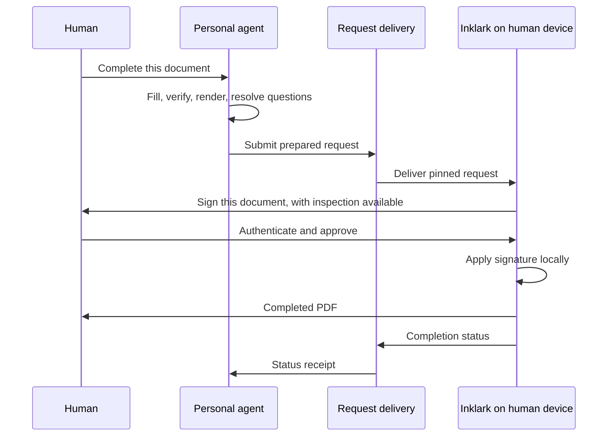

# Agent-driven signing journey

This is the target for the next release. The existing editor provides local MCP preparation, an encrypted signature vault, and human-approved PDF export. Remote MCP and durable encrypted delivery now pass local automation. Hosted authorization, a live cloud integration, and a physical-phone journey remain unverified.

See [the implementation status](BUILD-STATUS.md) for current evidence. The device-approval preview implements WebAuthn signing and encrypted request delivery separately from the existing editor. The [setup guide](REMOTE-SETUP.md) distinguishes implemented protocol behavior from verified clients.

## Product decision

An existing personal agent prepares the document. Inklark accepts a prepared signing request, obtains the person's approval, and produces the output on their device. A typed name is the proposed default signature appearance. Drawing or importing handwriting is optional. Creating an image vault must not be a prerequisite for the default flow.

The approval credential is the sensitive capability. A signature image is an optional asset. A typed or drawn appearance remains copyable from the finished PDF. Passkey authentication does not create a certificate-backed PDF signature or establish a person's legal identity by itself.

Electronic signature methods depend on the recipient, document, and applicable law. Ontario's Electronic Commerce Act recognizes information a person creates or adopts to sign a document and sets requirements and exceptions. Docusign lets signers adopt a predefined style, draw, or upload an image. These sources support making handwriting optional; they do not establish that every recipient will accept Inklark's output.

Sources: [Ontario Electronic Commerce Act, sections 1, 3, 11, 17, and 31](https://www.ontario.ca/laws/statute/00e17), [Docusign signature adoption](https://support.docusign.com/s/document-item?bundleId=yca1573855023892&topicId=dga1573854990297.html), [Docusign transaction evidence](https://www.docusign.com/trust/security/transaction-data-use).

## First use

1. Open the HTTPS web app on the human's device. Installation to the home screen is optional.
2. Set the name to use when signing and explicitly adopt the default typed appearance. Offer handwriting as a preference after the default setup.
3. Enroll a supported user-verifying approval credential. Explain recovery and test it before accepting a real request. A password fallback must preserve approval requirements and identify its different guarantees.
4. Choose an agent and complete its supported connection flow. Use local MCP for local clients and authenticated remote MCP for cloud clients. Provide a file handoff where a client cannot connect. Keep configuration text in an advanced section.
5. Pair the agent with the human's approval device. The pairing grants preparation and status access. It grants no approval, vault, or signing operation. Provide a visible way to revoke it.

An email account is not a product requirement. Pairing still needs authenticated credentials and a recovery design. Agent-platform accounts, plans, connector permissions, and confirmation prompts remain outside Inklark's control.

## Each document

| Stage    | Agent or system work                                                                                                                                                   | Human experience                                                                                                                              |
| -------- | ---------------------------------------------------------------------------------------------------------------------------------------------------------------------- | --------------------------------------------------------------------------------------------------------------------------------------------- |
| Ask      | Accept the user's document and instruction through their existing agent.                                                                                               | Ask the agent to complete the document.                                                                                                       |
| Prepare  | Preserve existing content, fill from authorized sources, render the draft, and propose signer and placements. Treat document instructions as untrusted data.           | Answer focused questions only where needed.                                                                                                   |
| Resolve  | Resolve missing or conflicting facts before creating an approval request. Record sources as agent claims. Unknown declarations and consent require an explicit answer. | Provide the necessary decision without repeating known routine details.                                                                       |
| Deliver  | Send the prepared request to the paired device through the supported local or remote path. Pin its version and content.                                                | Open the signing handoff. Do not require finding or opening the editor manually.                                                              |
| Present  | Display the document title, signer, and a concise account of the requested signing action. Make the actual prepared document and changes available to inspect.         | Choose **Sign this document** or inspect, correct, or reject it. A separate review checkbox is absent from the target flow.                   |
| Approve  | Require fresh user verification for that request. Bind approval to the document, signer, appearance revision, and placements. Reject stale or reused requests.         | Complete device authentication. Authentication is an approval action for this request, rather than a general grant to sign pending documents. |
| Apply    | Apply the adopted appearance locally and produce the PDF. Keep optional decrypted signature assets out of agent responses and the relay.                               | Receive the completed document.                                                                                                               |
| Complete | Report completion status. Preserve a local receipt linked to the output hash.                                                                                          | Download, share, or use a previously authorized delivery destination.                                                                         |

Opening the human app may require following a link or a notification. We must test these interactions in each host. Background mobile browsers and agent apps cannot be assumed to open an approval surface automatically.

## Signature and signer choices

The proposed default is a readable typed name the human adopts, placed where the agent requests. Optional handwriting keeps the existing encrypted asset vault. Initials can follow the same adoption and approval rules. The first release of this journey handles one human signer per request.

The signer must match the approving profile. A saved spouse's name or signature does not confer authority to sign as that person. Another person's approval and explicit representative-signing workflows require separate treatment. Never choose a household member's identity from context alone.

An incoming request in another signing service may require that service's workflow. Inklark must not replace its signature envelope with an independently edited PDF and claim the original workflow was completed. Existing certified or digitally signed PDFs retain the current protection against invalidating their signatures.

## Approval and evidence

Pin the prepared document bytes and an immutable manifest containing the signer, adopted appearance revision, placements, and signing intent. Use a fresh challenge, request version, expiry, and one-use approval. Editing, replacing the document, or changing the signer invalidates approval. Retries must not produce an additional authorization.

A typed appearance can be rendered before authentication, allowing approval to bind the candidate output hash. An encrypted handwriting asset may become available only after authentication. That path must bind the prepared document and fixed appearance instructions, verify the selected asset revision after unlock, and record the resulting output hash. Do not claim approval of a final-byte hash that was computed only after approval.

Use supported platform authentication with user verification. Detect cryptographic capabilities, including any passkey extension needed to decrypt an optional asset vault. A passkey assertion alone does not decrypt arbitrary encrypted data. Keep a documented fallback instead of silently reducing the protection.

The approval record should retain the request manifest, authentication evidence, and output hash needed to validate the binding. Keep credentials and secret key material out of it. Device timestamps are not trusted timestamps, public keys are not independently verified identities, and a local receipt is not a trusted signing-service audit certificate. A later certificate-backed PDF feature would require its own trust and interoperability work.

An agent with unrestricted access to the same browser or operating system remains inside the trusted-device boundary. For stronger isolation, approve on a separate trusted device. A compromised app build can also misuse data after unlock. Document this without promising that biometrics fix a compromised client.

## Cloud delivery and document privacy

Remote MCP is the agent connection; an encrypted relay is a proposed delivery mechanism. They solve different problems. HTTPS protects transport but does not stop the receiving server from seeing plaintext MCP arguments.

To keep a relay unable to read drafts, encrypt document payloads and answers for the paired device before upload. The preparation runtime or a compatible client adapter must perform this encryption. A generic MCP tool call that submits a plaintext PDF to the relay does not meet this requirement. Clients unable to encrypt and transfer an artifact need an explicit browser/file fallback until an adapter exists. Validate this with an actual cloud client before advertising compatibility.

Keep approval credentials, asset-vault keys, and decrypted signature images on the human's device. The relay accepts bounded, expiring encrypted requests and status messages. Pairing must prevent routing a request to an attacker-substituted device key. Use revocation, replay protection, resource limits, and deletion. A relay can still observe traffic metadata.

Signed PDFs go to the human by default. Returning a signed PDF to an agent or another service is a separate delivery permission. Anyone receiving it can copy its visible mark. Receipt-only completion protects access to the resulting artifact but cannot make a publicly shared visual signature secret.

Keep local-only operation available. An open-source, self-hostable relay avoids dependence on one operator. Public free hosting needs resource limits and an operating-cost plan; free software does not guarantee unlimited free infrastructure.

## Proof before release

The first acceptance journey uses a synthetic PDF, an actual cloud agent, and a physical phone. Preparation runs without a graphical desktop. The agent's request reaches the paired phone; the human authenticates; the PDF is created there; the agent receives only the permitted status.

Required checks:

- The default typed-name path requires no signature image upload or asset-vault setup.
- Existing native values and painted page answers survive preparation and export.
- A complete request reaches approval without manual placement or mandatory full-document review.
- Missing or conflicting answers are resolved before approval is enabled.
- Different document bytes, placement changes, another signer, stale requests, expired challenges, and replayed approval all fail.
- Successful approval authorizes exactly one pinned request. Cancellation, interrupted authentication, and network retries never count as approval.
- The relay sees encrypted document payloads, and neither relay nor agent receives approval secrets or optional signature assets.
- Device pairing detects substitution, can be revoked, and has tested loss/recovery behavior.
- A request survives normal phone app switching. Offline, expired, canceled, and failed-export states have a clear retry path.
- Output verification detects a document that differs from the approved candidate or manifest. Completion distinguishes local creation, download initiation, and verified delivery.
- Verify Safari on a physical iPhone, Chrome on a physical Android phone, and supported desktop browsers. Test the actual authentication and vault-decryption capabilities on each.
- Test each named agent client separately. Document unsupported plans and surfaces, and test its fallback. Muse and Grokbot require identification before compatibility claims.

Measure agent preparation, request delivery, phone/app opening, authentication, and local rendering separately. Benchmark a prepared request on a warm device. Do not promise a subsecond end-to-end process or label a desktop viewport test as a physical-phone test.

## Delivery order

1. Prove typed-name adoption and one-request authenticated approval on the local signing engine, including rejection and replay tests.
2. Prove encrypted handoff from one cloud client to a physical phone, using a client adapter where required. This is the milestone that validates the architecture.
3. Add guided pairing, recovery, and visible connection status. Preserve the local-only route and file fallback.
4. Verify the remaining agent clients and physical devices. Publish an honest compatibility table and a synthetic demonstration.
5. Package directory plugins around the same connection protocol. Consider native installers only where required for a concrete platform capability.

The existing application remains usable during this work. This document does not assert that the target journey or any new authentication mechanism is already available.
